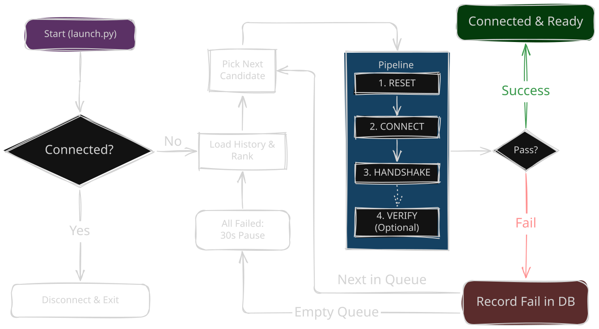

# Expresso ☕

Expresso tests ExpressVPN servers for you, one by one, and stays connected to the first one that works.

## Demo


## Features

- **Auto Scan & Hold:** Tries servers sequentially and stays connected to the first working location.
- **One-Click Launcher (`launch.py`):**
  - **Instant Toggle:** If already connected, disconnects immediately and exits without loading heavy modules.
  - **Auto-Start & Auto-Close:** If disconnected, opens ExpressVPN if needed, waits for its CLI, runs Expresso, and automatically closes the terminal window 5 seconds after connecting.
- **Fast-Path & Smart Ranking:** Remembers every attempt in SQLite (`~/.expresso/history.db`). Tries the last working server first, prioritizes reliable locations, and benches failing servers with an exponential cool-down.
- **Optional Traffic Verification:** Set `VERIFY_TRAFFIC = True` to probe multiple HTTPS endpoints and verify that your public IP changes before accepting a connection.
- **Animated Terminal UI:** Built with [rich](https://github.com/Textualize/rich), featuring a live tunnel animation, stage timers, activity log, and server leaderboard.

## Requirements

- Python 3.9+
- The ExpressVPN app installed, with its command-line tool available (`expressvpnctl` or `expressvpn`)
- `rich`

```bash
pip install rich
```

## Usage

### 1. One-Click Launcher (Recommended for shortcuts)

```bash
python launch.py
```

- **When connected:** Disconnects right away and exits.
- **When disconnected:** Starts ExpressVPN if necessary, runs the scanner, and closes the window automatically once the tunnel is stable.

### 2. Direct Scanner

```bash
python expresso.py                  # scan and connect
python expresso.py --demo           # preview the UI, no ExpressVPN needed
python expresso.py --reset-history  # forget what it has learned
```

Press `Ctrl+C` while scanning to stop and clean up any half-open tunnel. Once connected, pressing `Ctrl+C` closes the window while leaving the VPN connected.

## How it works



1. **Preflight Check:** Checks the current VPN state (disconnects and exits if already connected via `launch.py`).
2. **History & Ranking:** Tries the last known good server first, or loads all locations and ranks them using past success rates, latency, and cool-down streaks.
3. **Probe Pipeline:** For each candidate, runs **Reset** -> **Connect** -> **Handshake** (and optionally **Verify** for real HTTPS traffic and IP change).
4. **Result & Loop:** Stops at the first server that passes. Failed attempts are logged to `~/.expresso/history.db`, and if all servers in the queue fail, Expresso pauses for 30 seconds before starting the next round.

## Settings

Fine-tune behavior by editing the constants in `config.py`:

| Constant | Default | Description |
| :--- | :--- | :--- |
| `VERIFY_TRAFFIC` | `False` | Require real HTTPS traffic and IP change through the tunnel |
| `CONNECT_WAIT` | `8.5` | Max seconds to wait for the `connected` handshake |
| `MANUAL_LOCATIONS` | `[]` | Custom list of locations to test instead of all regions |
| `BENCH_AFTER` | `2` | Consecutive failures before a server is put on hold ("resting") |
| `BENCH_BASE_MIN` | `10` | Initial cool-down in minutes (doubles on each extra failure) |
| `ROUND_PAUSE` | `30` | Pause in seconds between full rounds when every server fails |
| `CLOSE_AFTER` | `5` | Seconds to keep the window open after connecting |
| `READY_TIMEOUT` | `60` | Max seconds to wait for the ExpressVPN service to start |

## Disclaimer

Expresso is an unofficial, independent tool. It is not affiliated with or endorsed by ExpressVPN. Use it at your own risk.