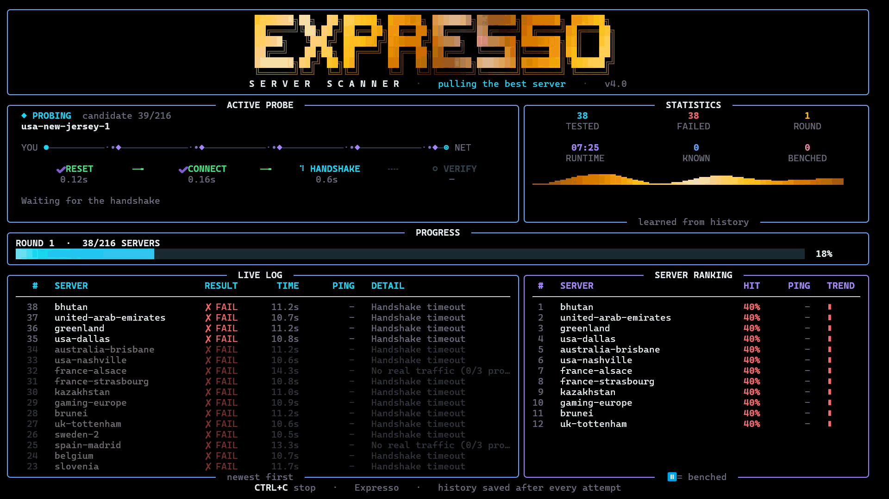

# Expresso ☕

Expresso tests ExpressVPN servers for you, one by one, and stays connected to the first one that connects.

## Demo



## Features

- **Auto scan:** tries servers until one connects, then keeps the connection.
- **Simple goal:** connects as soon as ExpressVPN reports a working connection, then stops.
- **Optional traffic check:** set `VERIFY_TRAFFIC = True` to also require real internet traffic through the tunnel.
- **Learns over time:** every attempt is saved. Good servers are tried first, and servers that keep failing are put on hold for a while.
- **Animated terminal UI** built with [rich](https://github.com/Textualize/rich).

## Requirements

- Python 3.9+
- The ExpressVPN app installed, with its command-line tool available (`expressvpnctl` or `expressvpn`)
- `rich`

```bash
pip install rich
```

## Usage

```bash
python expresso.py                  # scan and connect
python expresso.py --demo           # preview the UI, no ExpressVPN needed
python expresso.py --reset-history  # forget what it has learned
```

Press `Ctrl+C` to stop. Once connected, the script exits and the VPN stays connected.

## How it works

1. Gets the list of server locations and ranks them using your past results.
2. For each server: disconnect, connect, wait for the handshake (and optionally run the traffic check).
3. Stops at the first server that connects.
4. Saves every result to `~/.expresso/history.db` (SQLite).

## Settings

Edit the constants at the top of `expresso.py` (timeouts, health-check URLs, ranking and cool-down behavior, manual server list).

## Disclaimer

Expresso is an unofficial, independent tool. It is not affiliated with or endorsed by ExpressVPN. Use it at your own risk.
